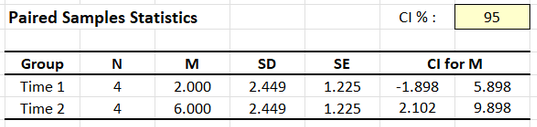
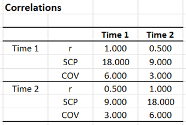

# [CREATE Articles](../index.md)

## Annotated Output | Correlations

### Computer Output

The table of descriptive statistics provides the baseline information.

{: .output}

> The descriptive statistics are calculated separately for each variable.

> Addition inferential information for the means is listed, but not relevant to the correlation.

The table of correlations shows the key elements to be interpreted.

{: .output}

> The upper left and lower right quadrants represent the relationship between each variable and itself. Because variables are perfectly correlated with themselves (*r* = 1.0), these correlations provide no useful information.

> In the upper left and lower right quadrants, the Sum of Cross Products (really the Sum of Squares) and Covariance (really the Variance) are useful as intermediary calculations. THe SCP and COV in the lower left quadrant describe the relationship between the two variables.

> The lower left quadrant represents the relationship between the two variables. Here, *r* = .500 indicates a positive relationship.

> The upper right quadrant is completely redundant with the lower left quadrant. Therefore, one can be ignored.

> Inferential information about the correlation is not presented in the output.

### APA Style

Correlations provide a measure of statistical relationship between two variables. Note that correlations can also have inferential information associated with them (and that this information should be summarized if it is available and of interest).

> For the participants (*N* = 4), the scores on Outcome 1 (*M* = 2.00, *SD* = 2.45) and Outcome 2 (*M* = 6.00, *SD* = 2.45) were moderately but not statistically significantly correlated, *r*(2) = .50, 95% CI [-0.89, 0.99], *p* = .500.
