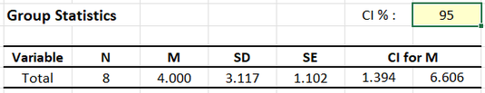
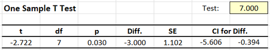

# [CREATE Articles](../index.md)

## Annotated Output | One Sample t Test

### Computer Output

The table of descriptive statistics provides the baseline information.

{: .output}

> The values of the descriptives statistics are identical to the values that would be provided by the “Descriptives” procedure.

The table of inferential statistics shows the key elements to be interpreted.

{: .output}

> With *t* = -2.722, *p* = .030. This would be considered a statistically significant finding.

> Using "CI for Diff", the researcher concludes that the true population mean difference is somewhere between -5.606 and -0.394 (knowing that the estimate could be wrong).

> Though not shown here, Cohen's d equals -0.963. Given Cohen's heuristics for interpreting effect sizes, this would be considered a large effect.

### APA Style

For this analysis, a sample mean has been compared to a user-specified test value (or a population mean). Thus, the summary and the inferential statistics focus on that difference.

> A one sample *t* test showed that the difference in Outcome scores between the current sample (*N* = 8, *M* = 4.00, *SD* = 3.12) and the hypothesized value (7.00) was large and statistically significant, *t*(7) = -2.72, *p* = .030, 95% CI [-5.61, -.39], *d* = -0.96.
