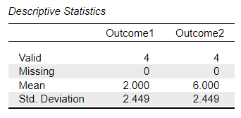
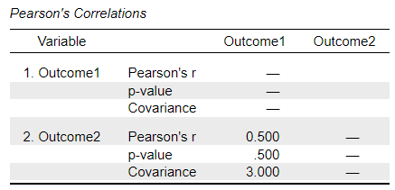

# [JASP Articles](../index.md)

## Annotated Output | Correlations

### Computer Output

The table of descriptive statistics provides the baseline information.

{: .output}

> The descriptive statistics are calculated separately for each variable.

The table of inferential statistics shows the key elements to be interpreted.

{: .output}

> The upper left and lower right quadrants represent the relationship between each variable and itself. Because variables are perfectly correlated with themselves (*r* = 1.0), these quadrants would provide no useful information.

> The lower left quadrant represents the relationship between the two variables. Here, *r* = .500 indicates a positive relationship.

> Though the statistic is not shown, *t* would provide the standardized statistic for testing whether the correlation differs from zero. This *t* value has a two-tailed probability (*p*) of .500, which would mean that this is not a statistically significant correlation.

> The upper right quadrant would be completely redundant with the lower left quadrant. Therefore, nothing is presented.

> A confidence interval for the correlation is not presented in the output.

### APA Style

Correlations provide a measure of statistical relationship between two variables. Note that correlations can also have inferential information associated with them (and that this information should be summarized if it is available and of interest).

> For the participants (*N* = 4), the scores on Outcome 1 (*M* = 2.00, *SD* = 2.45) and Outcome 2 (*M* = 6.00, *SD* = 2.45) were moderately but not statistically significantly correlated, *r*(2) = .50, 95% CI [-0.89, 0.99], *p* = .500.
