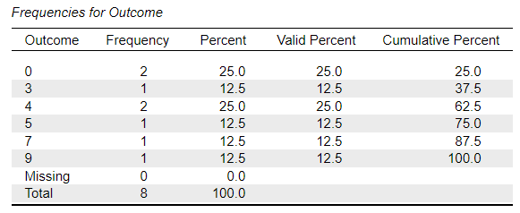

# [JASP Articles](../index.md)

## Annotated Output | Descriptives

### Computer Output

The frequency distribution provides the baseline information.

{: .output}

> The first column lists all the actual scores in the entire data set.  

> “Frequency” indicates the number of times that score exists. For example, the score of 4 was listed 2 times.

> The “Percent” column provides the percentage of cases for each possible score. For example, of the 8 scores in the entire data set, the score of 4 was listed 2 times and 2/8 is 25.0%.  

> The “Valid Percent” column provides the percentage of cases for each possible score divided by the total number of cases. Here, there were no missing scores, so the percent columns are equal.  

> “Cumulative Percent” is the SUM of all percentages up to and including the row in question. For example, 62.5% of scores were 4 or less. Similarly, 37.5% were 3 or less.

The table of descriptive statistics shows the key elements to be interpreted.

{: .output}

> Here, the mean (4.000), standard deviation (3.117), and variance/mean squares (9.714) are clearly marked.

> The number of people who did not have a score (i.e., missing) is useful for diagnostic purposes.

### APA Style

The purpose of descriptive statistics is to provide the reader with an idea about the basic elements of the group(s) being studied. Note that this also forms the basis of the in-text presentation of descriptive statistics for other inferential analyses.

> The participants (*N* = 8) had a low mean Outcome score (*M* = 4.00, *SD* = 3.12).
