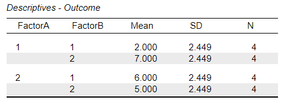
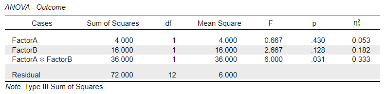

# [JASP Articles](../index.md)

## Annotated Output | Factorial ANOVA

### Computer Output

The table of descriptive statistics provides the baseline information.

{: .output}

> The descriptive statistics are calculated separately for each group or condition. They are not equivalent to getting the statistics for the variable as a whole.

The table of inferential statistics shows the key elements to be interpreted.

{: .output}

> For the Factor A Main Effect, *F* = 0.667, *p* = .430. This would not be considered a statistically significant finding.
>
> For the Factor B Main Effect, *F* = 2.667, *p* = .128. This would not be considered a statistically significant finding.
>
> For the Interaction, *F* = 6.000, *p* = .031. This would be considered a statistically significant finding.

> For the Factor A Main Effect, partial eta 2 = 0.053. Thus, 5.3% of the variability among the scores is accounted for by Factor A.
>
> For the Factor B Main Effect, partial eta 2 = 0.182. Thus, 18.2% of the variability among the scores is accounted for by Factor B.
>
> For the Interaction, partial eta 2 = 0.333. Thus, 33.3% of the variability among the scores is accounted for by interaction of Factor A and Factor B.

> For Factorial ANOVA, the confidence intervals around (centered on) each mean are appropropriate but not provided in the output.

### APA Style

The Factorial ANOVA provides statistics for the main effects and interactions in a factorial design. Each effect would be summarized in a style analogous to a One Way ANOVA.

> A 2 (Factor A) x 2 (Factor B) ANOVA indicated a small and non-statistically significant main effect for Factor A, *F*(1,12) = 0.67, *p* = .430, partial *η2* = .05, and for Factor B, *F*(1,12) = 2.67, *p* = .128, partial *η2* = .18. In contrast, the interaction was large in magnitude and statistically significant, *F*(1,12) = 6.00, *p* = .031, partial *η2* = .33.

Typically, the means, standard deviations, and confidence intervals would be presented in a table or figure associated with this text.
