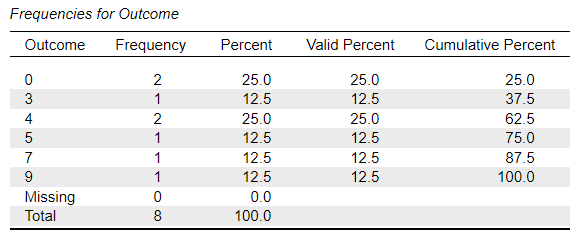
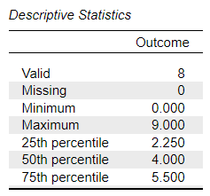

# [JASP Articles](../index.md)

## Annotated Output | Frequencies

### Computer Output

The frequency distribution provides the baseline information.

{: .output}

> The first column lists all the actual scores in the entire data set.  

> “Frequency” indicates the number of times that score exists. For example, the score of 4 was listed 2 times.

> The “Percent” column provides the percentage of cases for each possible score. For example, of the 8 scores in the entire data set, the score of 4 was listed 2 times and 2/8 is 25.0%.  

> The “Valid Percent” column provides the percentage of cases for each possible score divided by the total number of cases. Here, there were no missing scores, so the percent columns are equal.  

> “Cumulative Percent” is the SUM of all percentages up to and including the row in question. For example, 62.5% of scores were 4 or less. Similarly, 37.5% were 3 or less.

The table of descriptive statistics shows the key elements to be interpreted.

{: .output}

> The score at the 50th percentile is 4. Similarly, a score of 2.25 is at the 25th percentile and a score of 5.50 is at the 75th percentile.

### APA Style

Though often not reported, simple summary statistics like the median and quartiles provide the reader with basic frequency information about the variable under investigation.

> The participants (*N* = 8) had a low *Mdn* Outcome score of 4.00 (*IQR* = 2.25 – 5.50).
