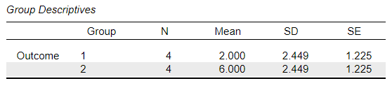
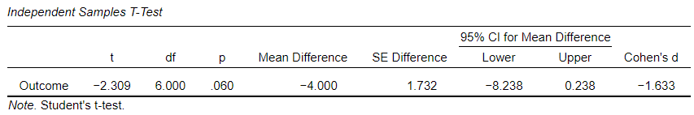

# [JASP Articles](../index.md)

## Annotated Output | Independent Samples t Test

### Computer Output

The table of descriptive statistics provides the baseline information.

{: .output}

> The values of the group statistics are calculated separately for each level or condition. They are not identical to the values obtained from analyzing the variable as a whole.

The table of inferential statistics shows the key elements to be interpreted.

{: .output}

> With *t* = -2.309, *p* = .060. This would not be considered a statistically significant finding.

> Using the "CI for Mean Difference", the researcher estimates that the true population mean difference is somewhere between -8.238 and 0.238 (knowing that the estimate could be wrong).

> Here, "Cohen's d" equals -1.633. Given Cohen's heuristics for interpreting effect sizes, this would be considered an extremely large effect.

### APA Style

For this analysis, the emphasis is on comparing the means from two groups. Here again the summary and the inferential statistics focus on the difference.  

> An independent samples *t* test showed that the difference in Outcome scores between the first group (*n* = 4, *M* = 4.00, *SD* = 2.45) and the second group (*n* = 3, *M* = 6.00, *SD* = 2.45) was large but not statistically significant, *t*(6) = -2.31, *p* = .060, 95% CI [-8.24, 0.24], *d* = -1.63.

Alternatively, the means, standard deviations, and confidence intervals could be presented in a table or figure associated with this text.
