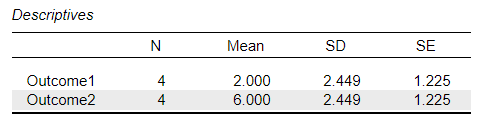
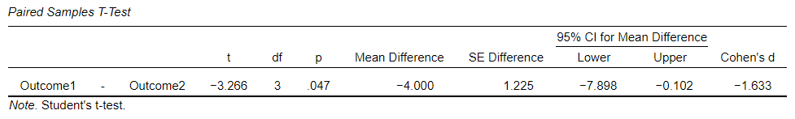

# [JASP Articles](../index.md)

## Annotated Output | Paired Samples t Test

### Computer Output

The table of descriptive statistics provides the baseline information.

{: .output}

> The descriptive statistics are calculated separately for each instance (which are shown as separate variables).

The table of inferential statistics shows the key elements to be interpreted.

{: .output}

> Here, *t* = -3.266 and *p* = .047. This would be considered a statistically significant finding.

> Using "CI for Mean Difference", the researcher estimates that the true population mean difference is somewhere between -7.898 and -0.102 (knowing that the estimate could be wrong).

> Cohen's d = -1.633. Given Cohen's heuristics for interpreting effect sizes, this would be considered an extremely large effect.

### APA Style

For this analysis, the differences between two measurements on one set of people are being compared. Thus, the summary and the inferential statistics focus on that difference.

> A paired samples *t* test showed that the difference in Outcome scores (*N* = 4) between the first time point (*M* = 2.00, *SD* = 2.45) and second time point (*M* = 6.00, *SD* = 2.45) was very large and statistically significant, *t*(3) = -3.27, *p* = .047, 95% CI [-7.90, -0.10], *d* = -1.63.

Alternatively, the means, standard deviations, and confidence intervals could be presented in a table or figure associated with this text.
