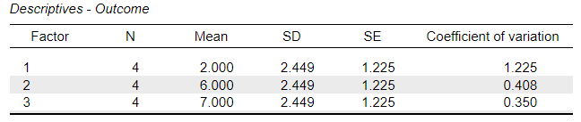
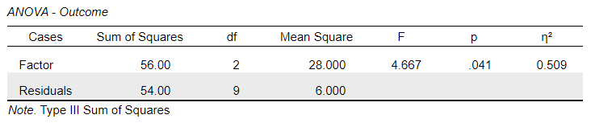
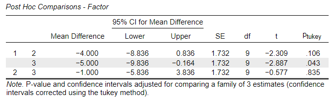

# [JASP Articles](../index.md)

## Annotated Output | Post Hoc Comparisons

### Computer Output

The tables of statistics provide the baseline information.

{: .output}

> The values of the group statistics are calculated separately for each group or condition. They are not identical to the values obtained from analyzing the variable as a whole.

The table of inferential statistics shows the key elements to be interpreted.

{: .output}

> The table from the ANOVA is useful in the intermediate steps for determining overall group differences and for providing some necessary information for calculations.

{: .output}

> For the 1 vs. 2 comparison, HSD = -2.309 and *p* = .106. This would not be considered a statistically significant diffeence.
>
> For the 1 vs. 3 comparison, HSD = -2.887 and *p* = .043. This would be considered a statistically significant difference.
>
> For the 2 vs. 3 comparison, HSD = -0.577 and *p* = .835. This would not be considered a statistically significant difference.

> For each comparison, the researcher estimates the true population mean difference adjusted for multiple comparisons (knowing that the estimates could be incorrect).
>
> For the 1 vs. 2 comparison, the 95% CI is [−8.836, 0.836].
>
> For the 1 vs. 3 comparison, the 95% CI is [−9.836, −0.164].
>
> For the 2 vs. 3 comparison, the 95% CI is [−5.836, 3.836].

> Cohen's d for each comparison can be calculated but is not shown here.

### APA Style

Post hoc tests build on the ANOVA results and provide a more focused comparison among the groups and usually follows a presentation of the ANOVA (which already includes the descriptive information).

> A series of Tukey's HSD comparisons revealed that the first group (*n* = 3, *M* = 2.00, *SD* = 2.45) scored substantially and significantly lower Outcome scores than the third group (*n* = 3, *M* = 7.00, *SD* = 2.45), 95% CI [-9.84, -.16], *t*(9) = -2.89, p = 043. However, the other comparisons revealed effectively little and not significant differences between the other groups (*p*s > .05).

Alternatively, the means, standard deviations, and confidence intervals could be presented in a table or figure associated with this text.
