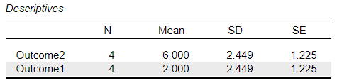
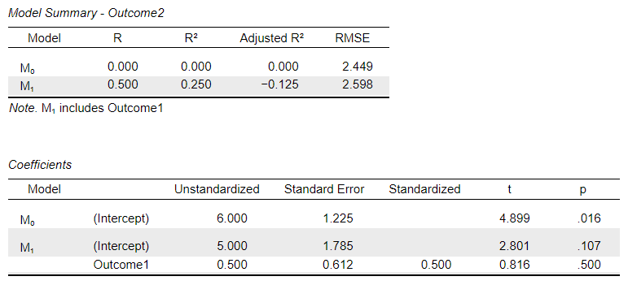

# [JASP Articles](../index.md)

## Annotated Output | Regression

### Computer Output

The table of descriptive statistics provides the baseline information.

{: .output}

> The descriptive statistics are calculated separately for each variable.

The tables of inferential statistics show the key elements to be interpreted.

{: .output}

> The model summary table shows a final R-Squared of .250. This represents a moderate amount of variance in Outcome 2 accounted for by Outcome 1.

> For the test of the regression coefficient associated with Outcome 1, the table shows a *t* of 0.816 and *p* of .500. This means that Outcome 1 did not statistically significantly predict Outcome 2.

### APA Style

Regression cofficients provide a measure of statistical relationship between two variables. Note that regression coefficients can also have inferential information associated with them (and that this information should be summarized if it is available and of interest).

> For the participants (*N* = 4), the scores on Outcome 1 (*M* = 2.00, *SD* = 2.45) moderately but not significantly predicted Outcome 2 (*M* = 6.00, *SD* = 2.45), *R2*= .250, *β* = .500, *t* = 0.816, *p* = .500.
