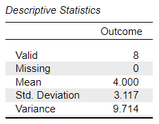
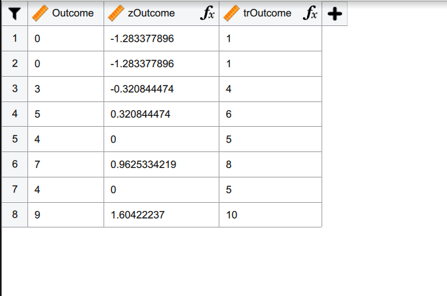

# [JASP Articles](../index.md)

## Annotated Output | Standardized Scores

### Computer Output

The table of descriptive statistics can be used to assist in calculating the standardized scores.

{: .output}

> The values of the descriptives statistics are identical to the values that would be provided by the “Descriptives” procedure.

Because each score gets tranformed into a standardized score, the standardized scores are presented in the data file (not the output).

{: .output}

> The variables in the data set can then be used for subsequent calculations.

### APA Style

Standardized scores are typically NOT presented in the summary of the data. Rather, they are often a first step in the calculations. As such, APA style is not presented here.
