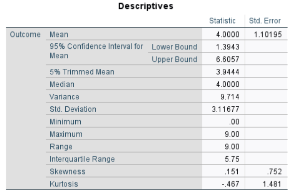

# [SPSS Articles](../index.md)

## Annotated Output | Confidence Interval for a Mean

### Computer Output

The table of descriptive statistics provides the baseline information.

{: .output}

The table of inferential statistics shows the key elements to be interpreted.

{: .output}

> These values of the descriptives are identical to the values that would be provided by the “Descriptives” procedure.

> Using the "confidence interval", the researcher concludes that the true population mean is likely between 1.394 and 6.606 (knowing that the estimate could be incorrect).

### APA Style

Confidence intervals provide a range estimate for a population value (e.g., the mean). Note that the width of the interval can be altered to reflect the level of confidence in the estimate.

> The participants (*N* = 8) scored low on the Outcome (*M* = 4.00, *SD* = 3.12), 95% CI [1.39, 6.61].
