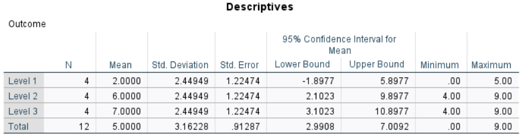
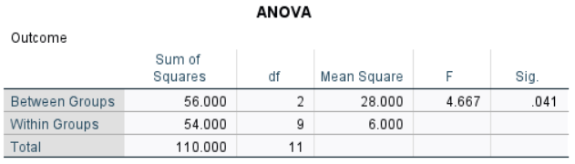

# [SPSS Articles](../index.md)

## Annotated Output | One-Way ANOVA

### Computer Output

The table of descriptive statistics can be used to determine the inferential statistics.

{: .output}

> The values of the group statistics are calculated separately for each group or condition. They are not identical to the values obtained from analyzing the variable as a whole.

> Confidence intervals for each mean are presented.

The table of inferential statistics shows the key elements to be calculated.

{: .output}

> Here, *F* = 4.667 and *p* = .041. This would be considered a statistically significant finding.

> The source table also shows that eta2 = 0.509. Thus, 50.9% of the variability among all of the scores in the study is accounted for by group membership.

### APA Style

The ANOVA provides an omnibus test of the differences across multiple groups. Because the ANOVA tests the overall differences among the groups, the text discusses the differences in general.

> A one way ANOVA showed that the differences in Outcome scores between the first group (*n* = 3, *M* = 2.00, *SD* = 2.45), the second group (*n* = 3, *M* = 6.00, *SD* = 2.45), and the third group (*n* = 3, *M* = 7.00, *SD* = 2.45) were large and statistically significant, *F*(2,9) = 4.67, *p* = .041, *η2* = .51.

Alternatively, the means, standard deviations, and confidence intervals could be presented in a table or figure associated with this text.
