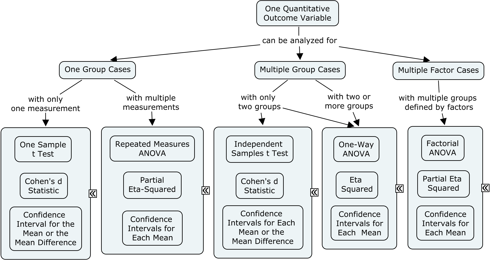
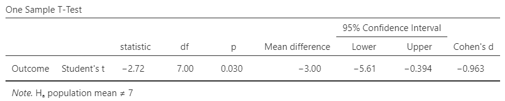

## [Basic Statistical Methods for Social Science](./index.md)

`Sourcebook` is an online textbook that is intended to facilitate the connection between standard introductory statistics concepts and their implementation in statistical software.

### Learning Goals

The Sourcebook materials are organized to facilitate both applied data analysis and teaching, making it suitable for classroom instruction, self-study, and research support. With these materials, users should be able to:

- Choose and implement the appropriate analyses given the research design
- Demonstrate the connections between formulas, calculations, and computer output of analyses
- Summarize and interpret statistical analyses in correct APA style

{: .screenshot}

### Included Materials

This Sourcebook contains a wide range of materials designed to assist with the use of statistical software such as IBM SPSS, jamovi, JASP, R (base functions), EASI (an R package), and CREATE (a collection of Excel spreadsheets). To that end, it contains:

- Instructions and screenshots that show how to enter data in the software packages
- Instructions and screenshots that show how to navigate and analyze the data in the software packages
- Screenshots that show the software packages' output and annotations with interpretation

{: .output}

> Statistical Significance: The *t* statistic is the ratio of the mean difference (raw effect) to the standard error of the mean.
>
> $$ t = \frac{M_{DIFF}}{SE_M} = \frac{-3.000}{1.102} = -2.722 $$
>
> With *df* = 7, *p* = .030. This would be considered a statistically significant finding.

> Confidence Interval: For this design, the appropriate confidence interval is around (centered on) the mean difference (raw effect).
>
> $$ CI_{DIFF} = M_{DIFF} \pm (t_{CRITICAL} ) (SE_M) = -3.000 \pm (2.365) (1.102) = [ -5.606, -0.394 ] $$
>
> Thus, the researcher concludes that the true population mean difference is somewhere between -5.606 and -0.394 (knowing that the estimate could be wrong).

> Effect Size: Cohen’s *d* Statistic provides a standardized effect size for the mean difference (raw effect).
>
> $$ d = \frac{M_{DIFF}}{SD} = \frac{-3.000}{3.117} = -0.963 $$
>
> Given Cohen's heuristics for interpreting effect sizes, this would be considered a large effect.
