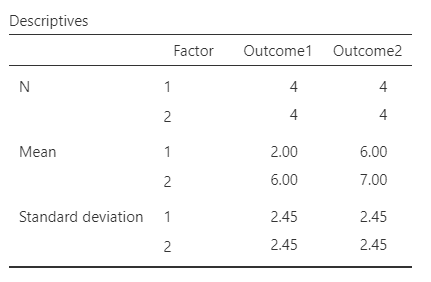
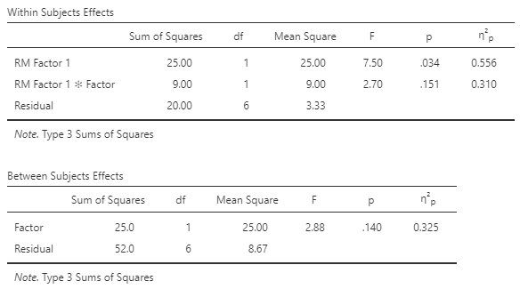

# [jamovi Articles](../index.md)

## Annotated Output | Mixed ANOVA

### Computer Output

The table of descriptive statistics provides the baseline information.

{: .output}

> The descriptive statistics are calculated separately for each group and time point. They are not equivalent to getting the statistics for the variable(s) as a whole.

The table of inferential statistics shows the key elements to be interpreted.

{: .output}

> For the Factor Main Effect, *F* = 2.885, *p* = .140. This would not be considered a statistically significant finding.
>
> For the Time Main Effect, *F* = 7.500, *p* = .034. This would be considered a statistically significant finding.
>
> For the Interaction, *F* = 2.700, *p* = .152. This would not be considered a statistically significant finding.

> For the Factor Main Effect, partial eta2 = 0.325. Thus, 32.5% of the variability among the scores is accounted for by Factor.
>
> For the Time Main Effect, partial eta2 = 0.556. Thus, 55.6% of the variability among the scores is accounted for by Time.
>
> For the Interaction, partial eta2 = 0.310. Thus, 31.0% of the variability among the scores is accounted for by the Factor × Time interaction.

> For Mixed ANOVA, the confidence intervals around (centered on) each mean are appropropriate but not provided in the output.

### APA Style

The mixed ANOVA provides statistics for the main effects and interaction in a mixed design. Each effect would be summarized in a style analogous to a Factorial ANOVA.

> A 2 (Factor) × 2 (Time) mixed ANOVA showed that the small main effect of Factor was not statistically significant, *F*(1,6) = 2.89, *p* = .140, partial *η*2 = .33, nor was the moderately sized interaction, *F*(1,6) = 2.70, *p* = .152, partial *η*2 = .31. However, the large main effect of Time was statistically significant, *F*(1,6) = 7.50, *p* = .034, partial *η*2 = .56.

Typically, the means, standard deviations, and confidence intervals would be presented in a table or figure associated with this text.
