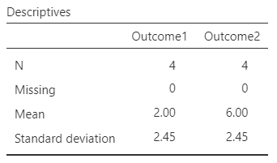
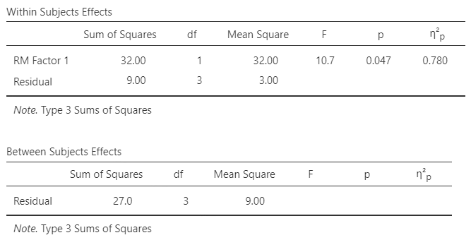

# [jamovi Articles](../index.md)

## Annotated Output | Repeated Measures ANOVA

### Computer Output

The table of descriptive statistics provides the baseline information.

{: .output}

> The values of the statistics are calculated separately for each instance (which are shown as separate variables).

The tables of inferential statistics show the key elements to be interpreted.

{: .output}

> Here, *F* = 10.667 and *p* = .047. This would be considered a statistically significant finding.

> Partial eta2 is 0.780. Thus, 78.0% of the variability among Outcome scores (after removing individual differences) is accounted for by repeated measures Factor.

> For Repeated ANOVA, the confidence intervals around (centered on) each mean are appropropriate but not provided in the output.

### APA Style

The RMD ANOVA tests for overall differences across the repeated measures. As such, its summary parallels that of the One Way ANOVA.

> A repeated measures ANOVA showed that the difference in Outcome scores (*N* = 4) between the first time point (*M* = 2.00, *SD* = 2.45) and second time point (*M* = 6.00, *SD* = 2.45) was very large and statistically significant, *F*(1,3) = 10.67, *p* = .047, partial *η2* = .78.

Alternatively, the means, standard deviations, and confidence intervals could be presented in a table or figure associated with this text.
